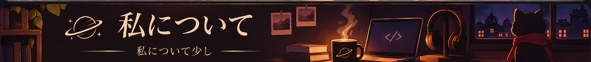

<!-- Banner principal -->

  

<!-- Seleção de idioma -->

  <strong>☕ 言語を選択してください</strong>

  
  
  

  ✓ 現在の言語：日本語

<!-- Guigo Links -->

  <strong>☕ Guigo Links を探索</strong>

  インターネット上にある、私の小さな居場所。 
  プロジェクトやSNSなど、さまざまな活動をまとめています。

  

<!-- 私について -->

  

  Guigoです。ブラジルでシステム分析・開発（ADS）を学んでいます。 
  コーヒーと創作が好きで、思いついたアイデアを自分のプロジェクトにするのが楽しみです。 
  Web開発やサイバーセキュリティ、コードとデザインを組み合わせることに興味があります。 
  私にとってプログラミングは、想像し、試しながら、自分らしいものを作る手段でもあります。

