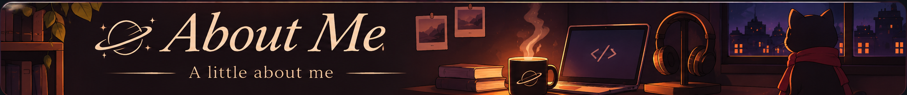

<!-- Banner principal -->

  

<!-- Seleção de idioma -->

  <strong>☕ CHOOSE YOUR LANGUAGE</strong>

  
  
  

  ✓ Current language: English (US)

<!-- Guigo Links -->

  <strong>☕ Explore Guigo Links</strong>

  My little corner of the internet. 
  Projects, social media and everything in between.

  

<!-- About Me -->

  

  I'm Guigo, a Brazilian student of Systems Analysis and Development (ADS). 
  I enjoy coffee, creativity, and turning ideas into projects of my own. 
  I like exploring web development, cybersecurity, and the space between code and design. 
  For me, programming is also a way to imagine, experiment, and build something with personality.

<!-- GitHub Activity -->

  <strong>☕ GitHub Activity</strong>

  Contribution Snake

  

  GitHub Stats

  

