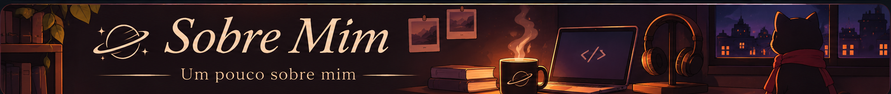

<!-- Banner principal -->

  

<!-- Seleção de idioma -->

  <strong>☕ ESCOLHA SEU IDIOMA</strong>

  
  
  

  ✓ Idioma atual: Português (Brasil)

<!-- Guigo Links -->

  <strong>☕ Explore Guigo Links</strong>

  Meu cantinho na internet. 
  Projetos, redes sociais e tudo o que existe entre eles.

  

<!-- Sobre Mim -->

  

  Sou o Guigo, estudante brasileiro de Análise e Desenvolvimento de Sistemas (ADS). 
  Gosto de café, criatividade e de transformar ideias em projetos próprios. 
  Tenho interesse em desenvolvimento web, cibersegurança e na mistura de código com design. 
  Para mim, programar também é uma forma de imaginar, experimentar e criar algo com personalidade.

<!-- GitHub Activity -->

  <strong>☕ Atividade no GitHub</strong>

  Cobrinha de contribuições

  

  Estatísticas do GitHub

  

